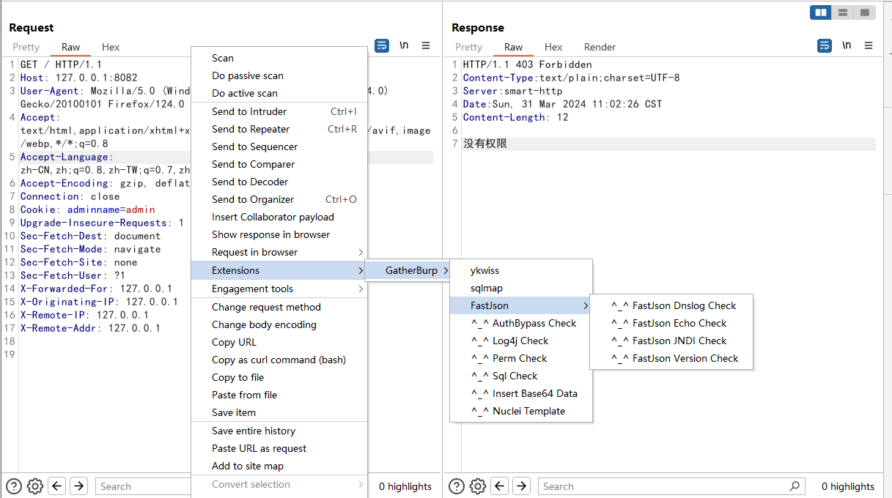
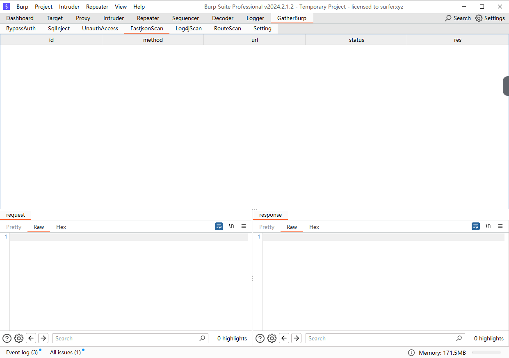
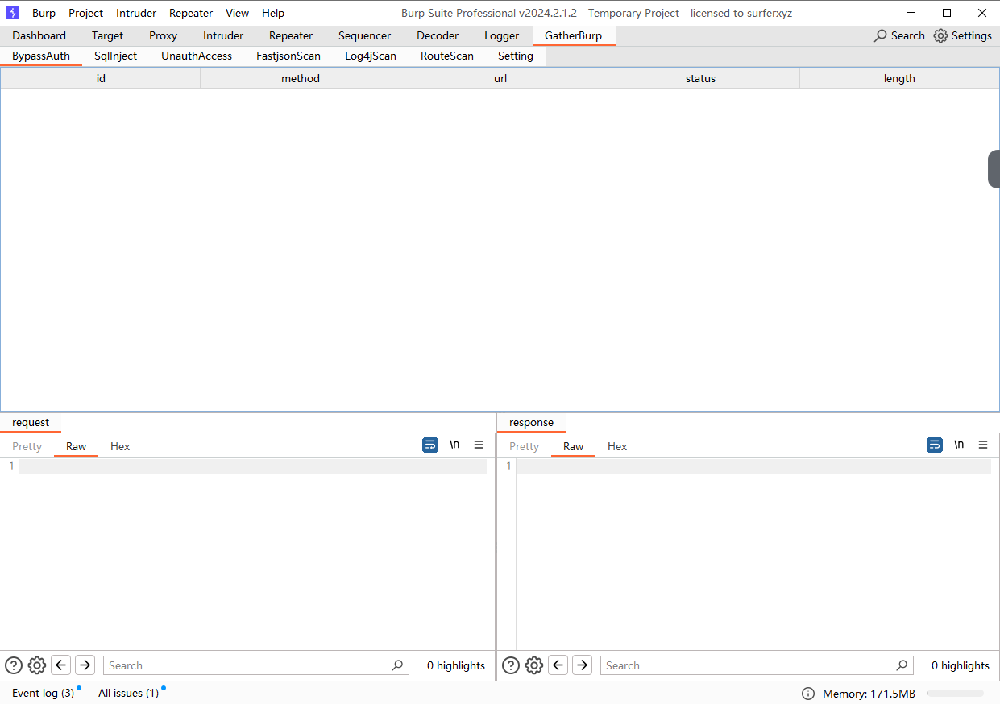

# GatherBurp

<div align="center">



[](LICENSE)
[](https://github.com/kN6jq/gatherBurp/stargazers)
[](https://github.com/kN6jq/gatherBurp/issues)
[](https://github.com/kN6jq/gatherBurp/releases)

**一款强大的 BurpSuite 安全测试扩展，集成多种漏洞检测与渗透测试功能**

[功能特点](#-功能特点) •
[快速开始](#-快速开始) •
[详细文档](#-详细文档) •
[贡献指南](#-贡献指南) •
[交流讨论](#-交流讨论)

</div>

## 📋 功能特点

GatherBurp 集成了多种安全测试功能，可大幅提升渗透测试和漏洞挖掘效率。

### 🔍 漏洞检测

- **Fastjson 漏洞扫描**
  - 支持 DNS 回连检测
  - 支持 JNDI 利用链检测
  - 支持回显检测（Tomcat、Spring 等环境）
  - 支持版本识别

- **SQL 注入检测**
  - 支持 GET、POST 参数检测
  - 支持 Cookie 参数检测
  - 支持多层级 JSON 参数检测
  - 支持报错注入、时间盲注、布尔盲注
  - 支持自定义 payload 和检测规则

- **Log4j 漏洞检测**
  - 支持 DNS 和 IP 回连检测
  - 支持参数和 Header 检测
  - 自定义 payload 列表

- **URL 重定向漏洞检测**
  - 自动检测常见重定向参数
  - 支持自定义 payload 和参数列表
  - 结果可按 ID 数值排序

### 🛡️ 权限测试

- **越权访问检测**
  - 支持原始请求、低权限请求和无权限请求对比
  - 自动分析响应长度差异
  - 结果可按 ID 数值排序

- **认证绕过测试**
  - URI 特殊字符绕过
  - Header 字段绕过
  - Accept 头绕过

### 🌐 信息收集

- **多层级路由扫描**
  - 支持复杂条件表达式过滤
  - 自定义字典和规则
  - 智能识别有效路径

- **相似域名收集**
  - 项目化管理目标，支持配置主域名
  - 被动收集相关子域名并自动解析 IP
  - URL 收集去重，支持一键复制

### 🔧 辅助工具

- **Nuclei 模板生成**
  - 一键生成 Nuclei 扫描模板
  - 支持多种漏洞类型

- **代理池功能**
  - 支持 SOCKS 代理
  - 多代理自动切换

- **伪造 IP 请求头**
  - 26 种常见客户端 IP 头多选（X-Forwarded-For、X-Real-IP、CF-Connecting-IP 等）
  - 支持随机国内 IP、127.0.0.1、自定义 IP
  - 应用范围可选（Proxy、Repeater、Intruder 等）
  - Intruder 随机 IP payload 生成器，爆破时每次换 IP

- **U2C 编码转换页签**
  - 消息编辑器附属页签，Unicode 转义（`\u7528\u6237`）自动转中文显示，双重转义也能解
  - JSON 内容自动美化排版并转中文
  - 一键轮换 UTF-8/GBK/GB2312/GB18030/Big5/Big5-HKSCS/UTF-16 编码，对付各类乱码
  - 只读展示，不影响原始请求/响应

- **DropPack 数据包丢弃**
  - 按规则自动丢弃/放行经过 Proxy 的流量（浏览器噪声、遥测上报、扫描器自身回连过滤）
  - 四种匹配方式：Host 精确与 `*.example.com` 通配子域名、URL 前缀（带边界防误吞）、关键字包含、正则
  - 右键菜单一键"丢弃此 Host/URL、按关键字丢弃、自动放行、取消命中此包的规则"，加规则前自动去重
  - 规则持久化到本地 SQLite，独立开关；每条规则统计命中次数，跨重启累积
  - 被丢/放行的请求打灰色标记并写 `Dropped/Forwarded by GatherBurp` 备注，HTTP history 可搜索筛查

- **复杂数据提交**
  - 支持 Base64 编码数据自动解码
  - 解决序列化数据编码问题

- **工具快速调用**
  - 支持自定义工具集成
  - 支持占位符：{url}、{host}、{request}

## 🚀 快速开始

### 安装要求

- JDK 1.8+
- BurpSuite Professional 2021.x+
- Maven 3.6+ (仅编译时需要)

### 编译安装

```bash
# 克隆仓库
git clone https://github.com/kN6jq/gatherBurp.git

# 进入项目目录
cd gatherBurp

# 编译打包
mvn clean package
```

编译后的 JAR 文件位于 `target/` 目录下。

### 在 BurpSuite 中加载

1. 打开 BurpSuite Professional
2. 进入 `Extender` -> `Extensions` 标签
3. 点击 `Add` 按钮
4. 选择 `Java` 类型，并选择编译好的 JAR 文件
5. 点击 `Next` 完成加载

### 基本使用

所有功能可通过以下方式访问：

1. **右键菜单**：在 Proxy、Repeater 等模块中右键点击请求
2. **扩展标签页**：在 BurpSuite 顶部标签栏中的 `GatherBurp` 标签

## 📚 详细文档

### Fastjson 扫描



**使用步骤：**

1. 在 `配置` 标签页设置 DNS 和 IP
2. 右键选择 `FastJson` -> 选择检测类型：
   - DNS 检测：适用于外网环境
   - JNDI 检测：支持 DNS/IP 回连
   - 回显检测：适用于内网环境
   - 版本检测：识别 Fastjson 版本

**高级配置：**

- DNS 扫描：配置类型为 dns，使用 FUZZ 占位符
- 回显检测支持多种环境：Tomcat、Spring 等

### SQL 注入检测

**功能特点：**

- 支持多种注入类型检测
- 支持参数、Cookie、Header、JSON 数据
- 支持自定义 payload 和错误关键字
- 支持白名单域名过滤
- 结果可按 ID 数值排序

**使用方法：**

1. 右键选择 `SQL Inject` 
2. 在标签页中配置检测参数
3. 查看检测结果和详细请求响应

### Log4j 漏洞检测

**功能特点：**

- 支持 DNS 和 IP 回连检测
- 支持参数和 Header 检测
- 自定义 payload 列表
- 结果可按 ID 数值排序

**使用方法：**

1. 右键选择 `Log4j Scan`
2. 在标签页中配置检测参数
3. 查看检测结果和详细请求响应

### 权限检测



**功能特点：**

- 支持原始请求、低权限请求和无权限请求对比
- 自动分析响应长度差异
- 结果可按 ID 数值排序

**使用方法：**

1. 右键选择 `Perm Check`
2. 在标签页中配置低权限和无权限认证信息
3. 查看检测结果和详细请求响应对比

### URL 重定向检测

**功能特点：**

- 自动检测常见重定向参数
- 支持自定义 payload 和参数列表
- 结果可按 ID 数值排序

**使用方法：**

1. 右键选择 `UrlRedirect`
2. 在标签页中配置检测参数
3. 查看检测结果和详细请求响应

### 多层级路由扫描

**表达式语法：**

```
code=200
body="hello"
title="druid"
headers="Content-Type: application/json"

# 复杂条件
code=200 && body="hello"
code!=200 && (body="hello" || title="druid")
```

**使用方法：**

1. 在 `Route` 标签页配置扫描参数
2. 设置字典和过滤条件
3. 开始扫描并查看结果

### 相似域名收集

**功能特点：**

- 项目化管理，支持为每个项目配置主域名列表
- 被动收集相关子域名与 URL，自动去重
- 自动解析域名 IP，解析超时自动跳过
- 结果表支持一键复制，数据本地 SQLite 存储

**使用方法：**

1. 在 `Similar` 标签页选择或新建项目
2. 配置项目的主域名
3. 开启扫描后，代理流量的相关域名和 URL 会自动收集入库

### 工具快速调用

**配置方法：**

1. 在 `配置` 标签页添加工具名称和命令
2. 支持以下占位符：
   - `{url}`: 当前请求的完整 URL
   - `{host}`: 当前请求的主机名
   - `{request}`: 当前请求的临时文件路径

**使用方法：**

右键菜单中选择配置好的工具名称即可快速调用

## 🤝 贡献指南

我们非常欢迎各种形式的贡献：

- 🐛 **报告 Bug**：提交详细的 Bug 报告，包括复现步骤
- 💡 **功能建议**：提出新功能或改进建议
- 📝 **文档改进**：完善或更正文档内容
- 🔧 **代码贡献**：提交 Pull Request 修复问题或添加功能

**贡献流程：**

1. Fork 本仓库
2. 创建功能分支 (`git checkout -b feature/amazing-feature`)
3. 提交更改 (`git commit -m 'Add some amazing feature'`)
4. 推送到分支 (`git push origin feature/amazing-feature`)
5. 提交 Pull Request

## 👥 交流讨论

加入微信讨论群：

请移步 Issues 查看群聊二维码

## 📋 未来计划

- [ ] 更多漏洞检测模块
- [ ] 性能优化和代码重构
- [ ] 完善文档和使用示例
- [ ] 支持更多自定义配置选项
- [x] 国际化支持（中英双语）

## 📝 更新记录

### V1.4.0（2026-11-27）

- 扫描任务按模块独立建池，移除跨模块共享队列和统一请求限速；一个模块排队不会再拖住其他模块
- 所有被动扫描支持立即取消：关闭开关后跳过排队任务、停止当前任务后续发包，取消不会误占 URL 去重
- 修复 Fastjson 四个右键菜单不执行、SQL 手动与被动扫描被拆成两个池的问题
- RouteScan 关闭再开启不会复活旧任务；无启用规则、零发包和取消场景不再污染去重
- SQL 注入修复 WAF 判定：基线不清除保护标记，数字盲注与引号盲注之间复检 WAF，触发保护后停止后续探针
- 修复 Log4j 空 payload、PermAccess 原始请求失败、UrlRedirect 无可测参数时误占去重的问题
- 插件卸载会中断并等待扫描任务退出，关闭 Similar DNS 池、SQL/Perm 保存池和 DropPack 定时器
- 主 UI 改到 EDT 初始化，模块初始化失败会回滚监听器；扫描中的弹窗被中断后可取消并关闭
- 全量回归：114 个测试通过

### V1.3.3（2026-11-17）

- 新增 DropPack 数据包丢弃页签：按规则自动丢弃/放行经过 Proxy 的流量，支持 Host 精确与通配、URL 前缀、关键字、正则四种匹配，右键一键加规则与撤销，规则持久化 + 命中计数（丢弃思路参考 [knife](https://github.com/bit4woo/knife)）
- BypassAuth 修复：手动扫描不做 URL 去重，重复右键直接重跑；新增 POST 路径变异开关（默认关，重放原 body 慎用于写接口）

- BypassAuth 新增方法级 403 绕过：原始请求 403/401 时自动换 POST/TRACE/OPTIONS/HEAD 重发（GET 被拦而 TRACE 放行是常见配置缺口）；只含无副作用方法，不自动发 PUT/DELETE
- BypassAuth 新增协议降级 403 绕过：HTTP/1.1 → HTTP/1.0 发两个变体（仅降版本 / 降版本并剥离全部请求头），部分 WAF 只按 1.1 语义拦截，降级后直通源站
- RouteScan 误报修复：Swagger Resources 规则的 `location` 特征词改为 `api-docs`，Actuator 移除弱特征词 `self`——登录页等普通页面的 JS 里这两个词太常见，软 404 目标上必撞
- 新增软 404 防护：每次探测前先请求一个随机不存在的路径，目标若对任意路径都返回同一张页面，本次所有命中一律不上报（全规则通用兜底）
- 老规则库自动迁移：已保存的旧表达式在插件加载时自动修正，无需 Reset Rules
- 探测路径组合前剥离 query 参数，不再产生 `?gotourl=.../actuator` 这类把 payload 拼进参数值的无效探测

### V1.3.2（2026-09-22）

- 新增 U2C 编码转换页签：消息编辑器内 Unicode 转义转中文显示，JSON 自动美化
- 一键轮换常用编码（UTF-8/GBK/GB2312/GB18030/Big5/Big5-HKSCS/UTF-16），每次从原始字节重新解释，不会叠加乱码
- 页签只读展示，原始请求/响应不受影响
- 功能参考开源项目 [u2c](https://github.com/bit4woo/u2c)，编码探测改用轻量的 juniversalchardet

### V1.3.1（2026-09-22）

- 新增 FakeIP 模块：按工具范围自动伪造客户端 IP 请求头（26 种头多选，随机国内 IP / 127.0.0.1 / 自定义）
- 提供 Intruder 随机 IP payload 生成器，配合 Pitchfork 爆破每次换 IP
- 功能集成自开源项目 [burpFakeIP](https://github.com/TheKingOfDuck/burpFakeIP)

### V1.3.0（2026-09-22）

- RouteScan：条件表达式解析器重写（支持 &&/||/括号/引号），默认规则扩充至 34 条
- 全模块审查修复：Fastjson、Log4j、SQL 注入、越权检测、认证绕过、SOCKS 代理池、Similar、设置等十余个模块
- Similar 模块稳定性提升：跨项目数据隔离、DNS 解析超时保护、表格与缓存内存封顶
- 界面全面支持中英双语

## ⚠️ 免责声明

本工具仅用于授权的安全测试和教育目的，请勿用于非法用途。使用本工具造成的任何后果由使用者自行承担。

## 📄 许可证

[MIT License](LICENSE)

---

<div align="center">

如果觉得这个项目对您有帮助，请给个 Star ⭐️ 支持一下！

</div>
